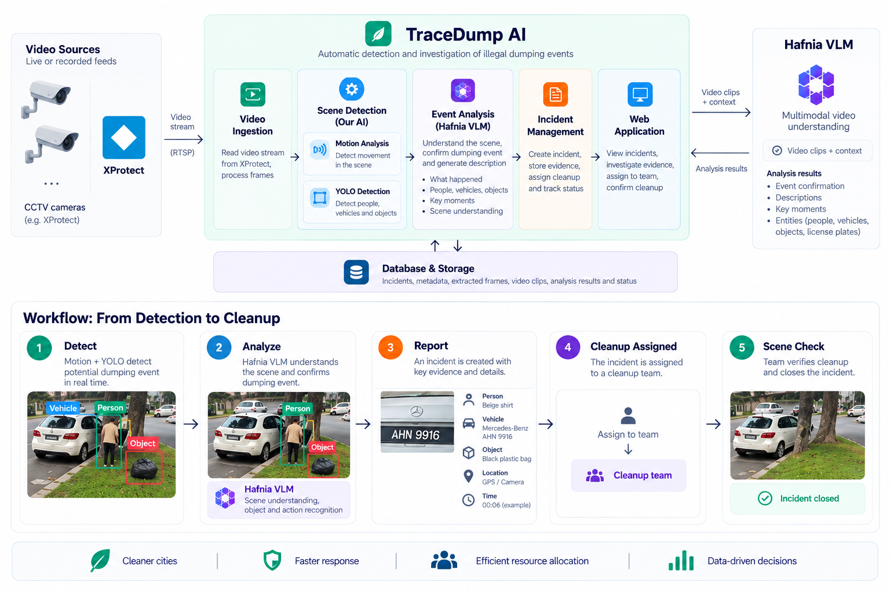

# TraceDump AI

TraceDump AI is an AI-powered platform that transforms existing CCTV infrastructure into an intelligent system for detecting illegal dumping and managing cleanup operations. By combining Milestone XProtect, computer vision, and Hafnia VLM, it automatically identifies suspected incidents, generates actionable reports with grounded visual evidence, streamlines cleanup coordination, and uses AI-powered scene verification to track incidents through resolution.

AI results are leads for human review, not confirmed incidents.



## Prerequisites

- Node.js 20.9+, Corepack, and pnpm
- Python 3.11-3.13
- A Supabase project, XProtect access, and Hafnia Gateway access
- For video workers: Windows, the XProtect MIP SDK, and `ffmpeg`/`ffprobe` on `PATH`

Apply the SQL files in [`database/migrations`](database/migrations) to Supabase in filename order, then create an investigator user in Supabase Authentication.

## Set up the webapp

```powershell
cd webapp
Copy-Item .env.example .env.local
corepack enable
pnpm install
```

Fill in `webapp/.env.local` with the Supabase browser credentials and server-only XProtect credentials.

## Set up video analytics

```powershell
cd video-analytics
Copy-Item .env.example .env
python -m venv .venv
.venv\Scripts\Activate.ps1
python -m pip install -e ".[dev,detection]"
```

Fill in `video-analytics/.env`. `SIMULATION_YOLO_MODEL` must point to a local `.pt` model; weights are not downloaded automatically.

## Launch

Open separate PowerShell terminals from the repository root.

```powershell
# Webapp -- http://localhost:3000
cd webapp
pnpm dev
```

```powershell
# Main monitoring/simulation worker
cd video-analytics
.venv\Scripts\Activate.ps1
video-analytics simulation-worker --no-recognize-plates
```

Start each supporting queue worker in its own terminal when using incident playback or cleanup scene checks:

```powershell
cd video-analytics
.venv\Scripts\Activate.ps1
video-analytics playback-worker
```

```powershell
cd video-analytics
.venv\Scripts\Activate.ps1
video-analytics scene-check-worker
```

Run `video-analytics check` to verify XProtect and Hafnia connectivity before processing video.
